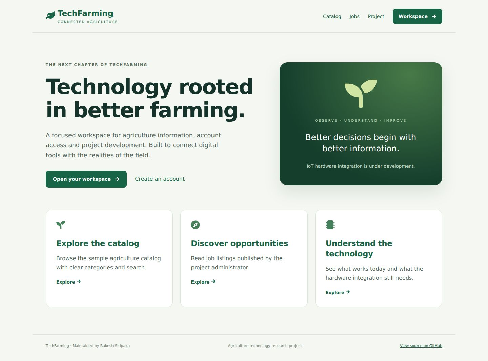

# TechFarming

**A connected-agriculture workspace built with React, Express and MySQL.**

TechFarming brings account access, project opportunities, a searchable sample agriculture catalog and device reporting into one responsive interface. Experimental Arduino and rover work is preserved alongside the website.

Maintained by **Rakesh Siripaka**. Original contributors and commit history are preserved. CareerOrbit is a separate project.



## Available features

- Validated signup and sign-in with database-backed, expiring cookie sessions.
- Session recovery after refresh, logout and administrator authorization.
- Administrator job publishing and searchable public listings.
- Searchable sample product catalog, clearly labeled as demonstration data.
- Account-scoped device registration, one-time device keys and key rotation.
- Validated temperature, humidity, moisture and pH reporting through a device-authenticated API.
- Recent device reports with timestamps and units, plus loading, empty and error states.
- Responsive navigation, labeled forms, keyboard focus and reduced-motion support.

## Scope and status

This is a development platform, not a completed commercial agriculture service. Catalog purchasing, seller accounts, payments, image classification and rover control are not active. Physical sensor calibration and hardware operation require verification. Device registration does not prove a sensor is connected.

The current build and local API/browser tests pass. See [verification evidence and remaining limits](docs/VERIFICATION.md) for the distinction between simulated test storage, real MySQL checks and physical hardware.

## Run locally

Use **Node.js 22.12 or newer** and MySQL. Run setup, configure `Server/.env`, and apply the reviewed migrations before starting.

```powershell
# From the repository root
npm run setup
```

Then follow [the setup guide](docs/SETUP.md). After database setup, `npm run dev` starts both services in one terminal. The API runs on port 9000 and the website on port 3001, leaving CareerOrbit’s port 3000 free. Configuration and real credentials stay outside Git.

## Documentation

| Guide | Purpose |
| --- | --- |
| [Setup](docs/SETUP.md) | Windows installation and startup |
| [Database](docs/DATABASE.md) | Versioned migrations, backups and recovery |
| [Authentication](docs/AUTHENTICATION.md) | Sessions, permissions and credentials |
| [Device API](docs/DEVICE-API.md) | Device registration and reporting contract |
| [Architecture](docs/ARCHITECTURE.md) | Application boundaries |
| [Hardware](docs/HARDWARE.md) | Original sketches and remaining implementation |
| [Verification](docs/VERIFICATION.md) | Tests and practical limits |
| [Roadmap](docs/ROADMAP.md) | Next development stages |

## Repository structure

| Directory | Contents |
| --- | --- |
| `client/` | React interface, Vite build and frontend lockfile |
| `Server/` | Express API, configuration, repository layer and tests |
| `Database/migrations/` | Account, session, device, telemetry and jobs migrations |
| `Server/ArduinoCode/` | Original experimental sensor and rover sketches |
| `Server/Python/` | Original experimental image-processing scripts |
| `.github/workflows/` | Automated build, API, MySQL and browser verification |

Read [Contributing](CONTRIBUTING.md) and [Security](SECURITY.md) before changing or deploying the project. No new project-wide license is introduced by this update.
