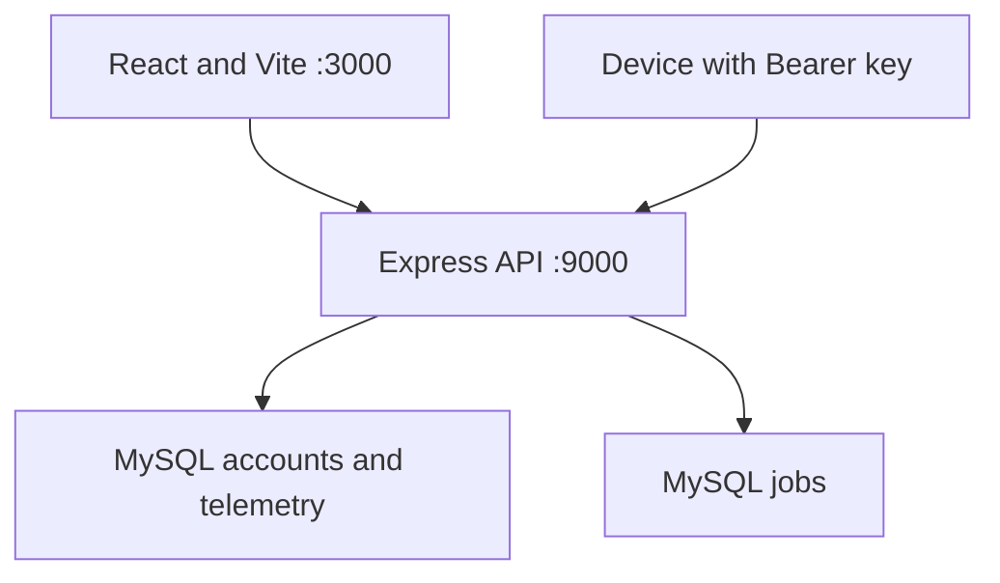

# Architecture

## Active application

The React frontend is built with Vite. The development and preview servers proxy `/api` requests to Express on port 9000. Express uses mysql2 connection pools and a repository layer for account, session, device, telemetry and jobs persistence.

The catalog reads the existing sample Products.json from an absolute path resolved against the server directory. It is not live inventory and does not support purchases. Original Python experiments and rover sketches remain in the repository but are not invoked as working services.

## Supported boundaries

| Boundary | Implementation |
| --- | --- |
| Accounts | Validated signup, bcrypt password hashing and safe profile responses |
| Sessions | Hashed random tokens, expiry and persistent MySQL storage |
| Jobs | Public read, authenticated administrator write |
| Devices | Per-owner registration, hashed keys, rotation and scoped history |
| Readings | Validated metrics and transactional reading/last-seen writes |
| Database setup | Versioned SQL, checksums, advisory locks and explicit recovery |
| Frontend | Accessible forms, navigation, loading/error states and responsive layouts |

The readiness endpoint verifies the required tables. Controlled API errors return JSON without raw database details or secrets.

## Development-only limitations

Physical hardware, calibration, commerce, payments, seller accounts, email services and rover/image functionality require separate implementation. Authentication rate limiting is local to one process. Production scaling, telemetry retention, observability and recovery drills remain further work.

Existing legacy UI source is preserved for reference, but the active router exposes only supported pages. Removed dependency packages belonged to the retired active UI or unused backend integrations; restoring those experiments requires their own reviewed dependency setup.
