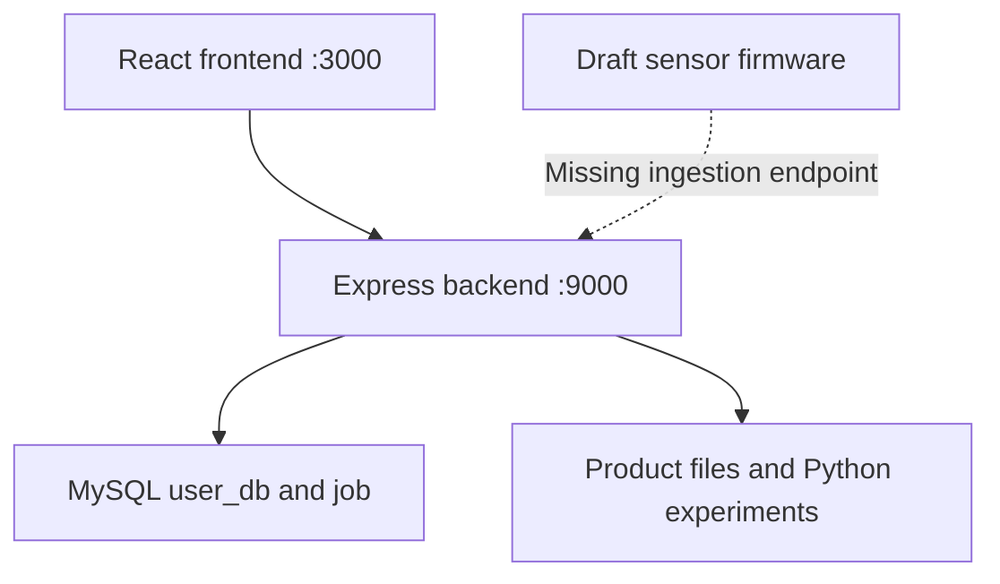

# Architecture

## Existing application

The React frontend uses Create React App. Its development server proxies API requests to the Express backend on port 9000. The backend connects directly to MySQL and includes product-file and Python processing experiments.

## Boundaries and known gaps

- User login checks a password hash but does not establish a complete authenticated session. Dependencies for JWT or sessions do not establish that those features are implemented.
- Public user and seller collection routes are disabled. Implement authenticated authorization before providing account-management APIs.
- Database settings load from `Server/.env` or the process environment. The backend defaults to a loopback listener and restricts browser CORS to one configured frontend origin. CORS is not authentication.
- SQL examples and route table expectations are inconsistent. A migration set is required.
- Job creation references undefined values; product file paths and capitalization need correction.
- The image classification route needs path, upload and subprocess output handling fixes.
- The soil sketch posts to a placeholder `/api/soil-data` endpoint that is not implemented in this server.
- Rover commands, device identity, telemetry persistence and hardware safety behavior remain unimplemented.

This documentation describes the committed legacy application. It does not claim that a replacement platform or production deployment has been completed.
