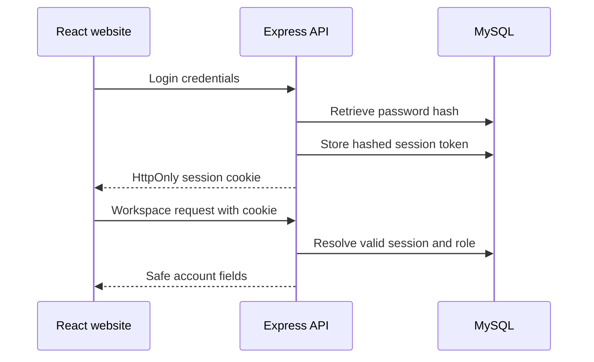

# Authentication and permissions

## Request flow

Signup validates the name, normalized email and password before storing a bcrypt hash. Passwords are not logged. Signup always creates a regular user; client-provided roles are ignored.

Login verifies the hash, invalidates a previous session cookie if present, and generates a cryptographically random 32-byte token. The raw token goes only into an HttpOnly, SameSite=Strict cookie. MySQL stores its SHA-256 hash, user ID and expiry. Sessions expire after 12 hours.

`GET /api/users/me` checks the persisted session and returns only ID, name, email and role. Logout deletes the stored session and clears the cookie. A process restart does not invalidate a session stored in MySQL.

## Permissions

- Account collection endpoints remain disabled.
- Job publishing requires both a valid session and an administrator role from MySQL.
- Device registration is available to authenticated users.
- Device listings, key rotation and reading history are scoped to the authenticated owner.
- Device reporting requires its own Bearer token and does not accept a browser session as authentication.

## Browser request protection

Mutating browser routes require the configured exact Origin. CORS allows one configured frontend origin, with credentials. Origin checks complement authentication; CORS alone is not authorization. Firmware's `/api/soil-data` route is exempt from browser Origin checking because it uses explicit per-device authentication.

Authentication attempts have a bounded in-process rate limit. This is appropriate for local testing, not a shared distributed rate-limit store. Use a trusted deployment plan before exposing the service publicly.

## Configuration and remaining work

Database credentials load from Server/.env or the process environment. Local listening defaults to loopback. Production mode requires an HTTPS CLIENT_ORIGIN and sets Secure cookies; local HTTP development does not set Secure.

Passwords are limited to 72 UTF-8 bytes to avoid bcrypt truncation. bcryptjs supports existing compatible bcrypt hashes; source: https://github.com/dcodeIO/bcrypt.js.

Email verification, password reset, multifactor authentication, seller accounts and external OAuth providers are not implemented. Do not present them as working sign-in options.
